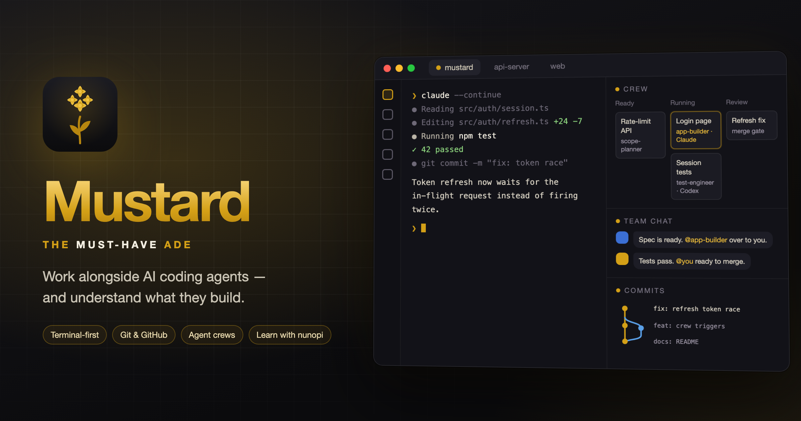

<p align="center">
  
</p>

<p align="center">
  <br>
  <b>Mustard</b> — the <b>must-have ADE</b> (Agentic Development Environment).<br>
  Work alongside AI coding agents, and understand what they build.
</p>

---

## Why

Coding agents write hundreds of lines in minutes. The bottleneck is no longer writing code — it is understanding, reviewing and owning what the agents produce.

At the same time, everything you need while working with an agent lives somewhere else: issues and PRs in the browser, research and plans in a Markdown app, previews in yet another tab. Every switch costs focus.

Mustard puts all of it around the terminal where your agents already run, and explains what they are doing while they do it.

## Features

### Workspace (terminal-first)
- **Terminal** — run Claude Code, Codex, OpenCode, Grok Build or Cursor as usual. Sessions live in a background daemon and survive app restarts.
- **Git** — commit graph, diffs, working-tree changes, branches.
- **GitHub** — issues, pull requests and CI checks next to the terminal.
- **Documents** — read research notes and plans (Markdown) in tabs, no context switch.
- **In-app browser** — preview your app, pick an element and hand it to the agent.
- **Multiple repos** — one tab per repository.

### Catch-up
- Live narration of what the agent is doing and why, from its tool calls.
- **Commit ↔ session** — for every commit, find the agent conversation that produced it (from your prompt to the end of the committing turn). Open it later in a review or an incident.
- Ask questions about any change; answers link back to the related cards.

### Crew — role-based agent teams
- A kanban board where role agents (scope planner, app builder, test engineer, release checker, …) pass cards to each other in an order enforced by code.
- Each role can use a different agent — e.g. Claude builds, Codex tests.
- Team chat: agents report to each other; `@mention` a role to start a card.
- Triggers: CI failures, labeled issues or schedules create cards automatically.
- Large tasks split into subtasks that run in dependency order.
- Every card works in its own git worktree. Agents never push or merge — humans approve specs, destructive data changes and merges, and open draft PRs with one click.

### nunopi — the learning module
Optional, built in. Paste code or tech writing and get line-by-line explanations, a term dictionary and concept cards; branch your questions into threads that stay organized; review terms with spaced-repetition decks.

nunopi is also available as a standalone app: **[h1tTAKA/nunopi](https://github.com/h1tTAKA/nunopi)** (synced automatically from this repository).

## Getting started

Requirements: macOS, Node.js 24, and at least one agent CLI you are logged in to (Claude Code, Codex, OpenCode, Grok Build or Cursor). Mustard uses your existing subscriptions — no API keys required.

```bash
npm install
npm run electron:dev        # desktop app (development)
npm run dev                 # web UI only (http://localhost:3000)
```

Package the desktop app:

```bash
npm run electron:dist:dir --workspace apps/mustard   # .app in apps/mustard/dist_electron
```

## Repository layout

```
apps/
  mustard/        Mustard desktop app (Next.js + Electron)
  nunopi/         nunopi standalone app
packages/
  core/           shared UI, i18n (ko / ja / en), agent runtime client
  nunopi/         nunopi learning module
scripts/
  export-nunopi.mjs   builds the standalone nunopi repository
```

## Contributing

Issues and pull requests are welcome on this repository — including changes to nunopi. The standalone nunopi repository is generated; changes made there are overwritten on the next sync.
